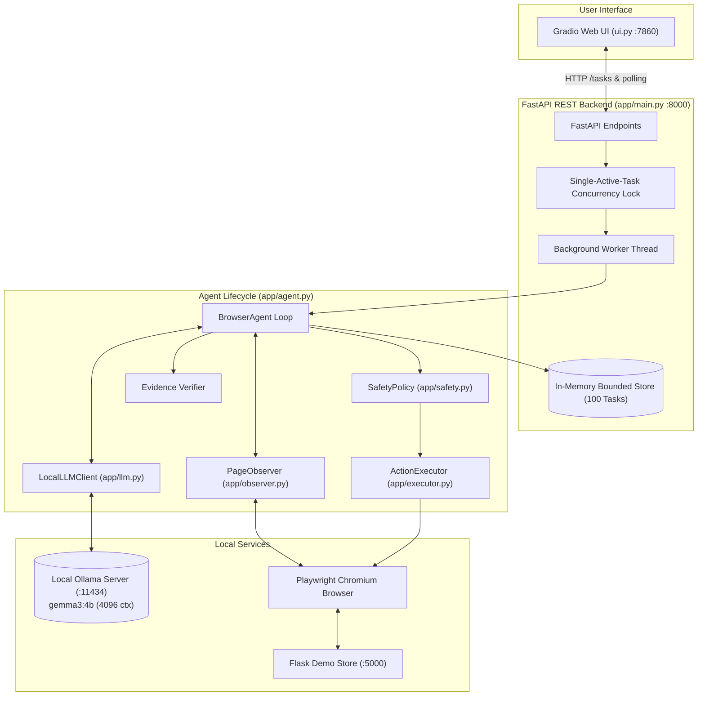
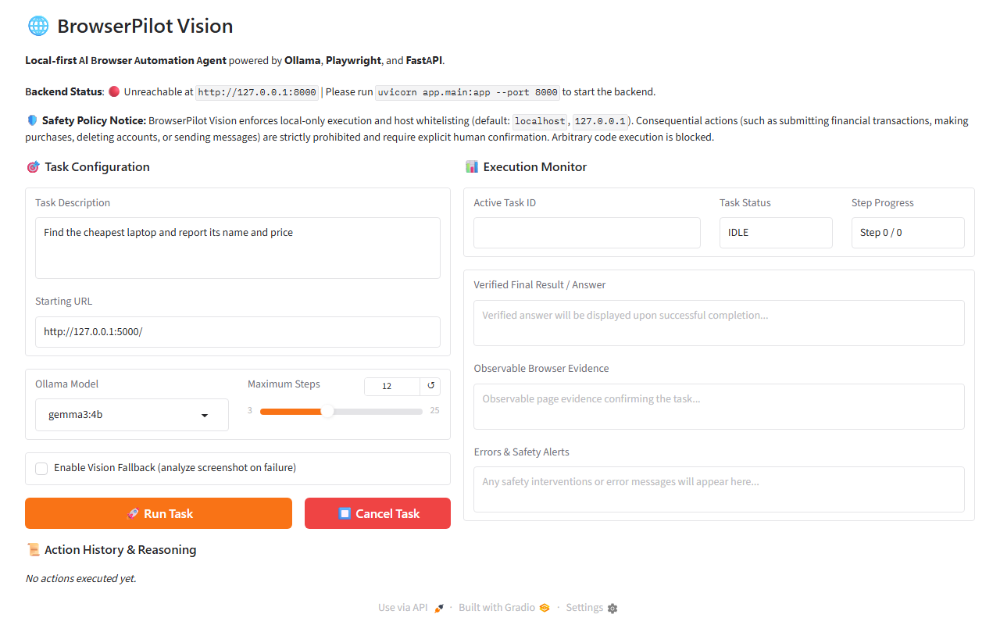
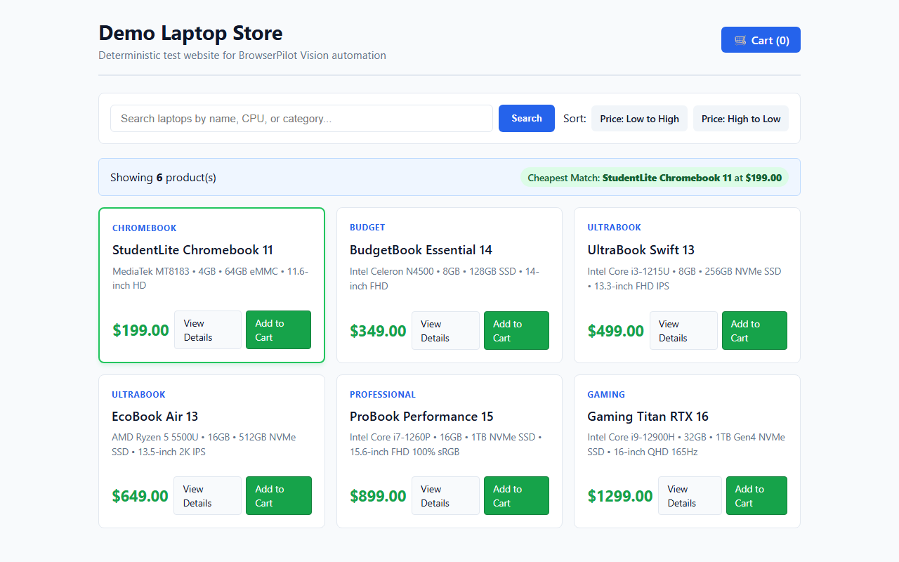
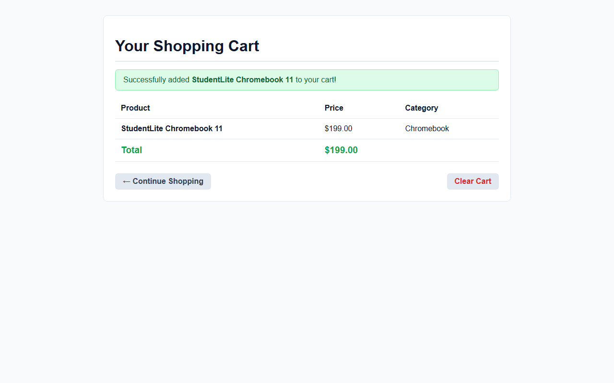

# BrowserPilot Vision

> **Autonomous, local-first AI browser automation agent designed from scratch for consumer hardware using local open-weight models, Playwright, and FastAPI.**

[](LICENSE)
[](https://www.python.org/)
[](https://fastapi.tiangolo.com)
[](https://playwright.dev/)
[-orange.svg)](https://ollama.ai)
[](tests/)

---

## 1. Problem Statement & Core Value

Traditional browser automation tools (Selenium, Puppeteer scripts) rely on brittle, hardcoded CSS/XPath selectors that break with minor website changes. While cloud-based AI browser agents have emerged, they introduce three critical liabilities:
1. **Severe Privacy & Data Leakage:** Transmitting live DOM trees, session cookies, personal credentials, and browser screenshots to external cloud APIs exposes users to data breaches and third-party tracking.
2. **High Recurring API Costs:** Large DOM contexts quickly exhaust cloud token limits, making continuous browser automation cost-prohibitive.
3. **Hallucinated "Success":** Cloud LLMs frequently claim a task succeeded (such as declaring a product was purchased or added to cart) when the website actually displayed an error banner or remained unchanged.

**BrowserPilot Vision** solves this by providing:
1. **100% Local-First Execution**: Runs entirely on consumer hardware (tested on an Intel Core i7-12650H with NVIDIA RTX 3050 Laptop GPU 4 GB VRAM) using Ollama (`gemma3:4b`) with zero external cloud API dependencies.
2. **Strict Security Sandboxing**: Built-in hostname whitelisting (`localhost`, `127.0.0.1`), prohibited scheme guards (`file:`, `javascript:`, `data:`), consequential action blockers (e.g. checkouts, password entry), and untrusted prompt injection delimiters.
3. **Independently Verified Task Completion**: Tasks do not succeed merely because the LLM returns `finish`; observable DOM state is verified against content keywords to detect and reject hallucinations.
4. **Decoupled Architecture**: A clean Gradio web interface communicating with a robust FastAPI backend managing single-task concurrency and non-blocking background workers.

---

## 2. What Makes BrowserPilot Vision Distinct from Generic Browser Macros?

| Feature | Generic Browser Macros (Selenium/Puppeteer) | Cloud-Based AI Agents | **BrowserPilot Vision** |
| :--- | :--- | :--- | :--- |
| **Execution Locality** | Local script | Remote cloud server | **100% Local (Consumer Laptop)** |
| **Task Input** | Hardcoded code/scripts | Natural language prompt | **Natural language prompt** |
| **Selector Resilience** | Rigid (breaks on DOM changes) | High (dynamic LLM reasoning) | **High (Dynamic accessible name resolution & contextual parent enrichment)** |
| **Data Privacy** | High (local) | Very Low (full DOM & cookies transmitted to cloud APIs) | **Guaranteed (Strictly local, secrets masked in logs and API)** |
| **Verification** | Simple assertions | Assumes success on LLM `finish` | **Closed-loop observable proof verification filtering generic stopwords** |
| **Security Controls** | None | Ad-hoc system prompts | **Defense-in-depth: Host whitelisting, prohibited schemes, consequential action blockers** |
| **API Costs** | None | $0.05–$0.20 per browser task | **$0.00 (Zero API costs)** |

---

## 3. Architecture Overview

BrowserPilot Vision employs a decoupled **Client-API-Agent-Browser** architecture:



### Component Roles

- **`app/config.py`**: Pydantic Settings reading environment variables, configuring Ollama URL, defaulting to `gemma3:4b`, enforcing 4096-token context size, request timeouts, and allowed hosts.
- **`app/schemas.py`**: Strict Pydantic v2 schemas defining allowed actions (`click`, `fill`, `goto`, `scroll`, `wait`, `finish`), input constraints, and execution records. Arbitrary Python/JS/shell commands are strictly rejected.
- **`app/safety.py`**: Security boundaries including URL scheme enforcement (`http` and `https` only), hostname whitelisting (`ALLOWED_HOSTS`), credential-bearing URL prevention, consequential action guards (e.g. purchases, checkouts, credential entry, account deletions), and untrusted web content delimiters.
- **`app/llm.py`**: Client for local Ollama instance with deterministic inference (`temperature=0.0`), Pydantic schema enforcement, single automatic retry with feedback on malformed JSON, and vision analysis for screenshots.
- **`app/observer.py`**: Extracts token-efficient, compact page summaries (page title, visible body text bounded to 3000 chars, accessible names, numbered interactive candidates with contextual parent enrichment) while excluding hidden or invisible elements.
- **`app/executor.py`**: Executes validated actions synchronously with Playwright on a single controlled browser tab. Resolves targets unambiguously, closes unexpected popup tabs, and checks post-navigation redirects.
- **`app/agent.py`**: Orchestrates the observe-plan-execute-verify cycle with step limits (default 12), recovery attempts (max 2), observable evidence verification, anti-thrashing loop detection, and safe browser shutdown.
- **`app/logger.py`**: Writes structured JSON Lines records to `data/<task_id>.jsonl` with automatic masking of sensitive credentials, passwords, cookies, and bearer tokens.
- **`app/main.py`**: Production FastAPI service providing `/health`, `/models`, `POST /tasks`, `GET /tasks/{task_id}`, and `POST /tasks/{task_id}/cancel` endpoints protected by a single-task concurrency lock (`409 Conflict`), safe validation (`400 Bad Request`), and Ollama availability checks (`503 Service Unavailable`).
- **`ui.py`**: Lightweight Gradio web interface connected to the FastAPI backend. Polls running tasks responsibly, displays live markdown action history, tracks step progress, and visualizes verified observable evidence.
- **`demo_site/app.py`**: Deterministic Flask laptop shopping site with search, pricing, filter interactions, detail views, and in-memory cart for reproducible end-to-end testing.

---

## 4. Visual Evidence & Interface

### Gradio Web User Interface (`ui.py`)

*Interactive web interface showing real-time backend/model status, task inputs, max steps slider, vision fallback toggle, and execution monitors.*

### Local Demo Laptop Store (`demo_site/app.py`)

*Deterministic local shopping store with search, low-to-high pricing filters, product cards, and semantic accessible targets.*

### Verified Observable Cart State

*Observable cart page verified by BrowserPilot Vision upon adding the StudentLite Chromebook 11 for $199.00.*

---

## 5. Hardware Optimization (Tuned for 4 GB VRAM)

BrowserPilot Vision is tuned for consumer laptops with **4 GB VRAM (e.g., NVIDIA RTX 3050 Laptop GPU)** and **16 GB RAM**:

- **Default Context Window**: `4096` tokens (`num_ctx=4096`) to keep memory footprint bounded.
- **Single Active Task Lock**: Only one active browser task and one LLM inference stream at a time (enforced via `active_task_lock`). Concurrent submissions receive `409 Conflict`.
- **Compact Observations**: Visible page text is capped at 3,000 characters; raw DOM trees are never sent to the LLM.
- **Bounded History**: The agent only passes the last 4 recent action outcomes to avoid prompt inflation.
- **No Cloud APIs**: Everything runs strictly locally; no API keys or cloud services required.
- **Inspection of GPU / CPU Placement**: Because 4B models (~3.5 GB) may exceed free VRAM when Windows display processes are active, Ollama splits layers between CPU and GPU. Inspect placement anytime in PowerShell:
  ```powershell
  ollama ps
  ```
  *Example output:*
  ```text
  NAME         ID              SIZE      PROCESSOR          CONTEXT    RUNNER
  gemma3:4b    68ceab7e468a    3.5 GB    56%/44% CPU/GPU    4096       llamacpp
  ```

---

## 6. Supported Local Models

Ollama must be installed and running locally on `http://localhost:11434`.

| Model Name | Type | Recommended Use |
| :--- | :--- | :--- |
| `gemma3:4b` *(Default)* | Multimodal (Text + Vision) | Primary model for autonomous agent tasks and visual analysis |
| `qwen3:4b` | Text-oriented | Alternative high-reasoning agent model |
| `qwen2.5:1.5b-instruct-q4_K_M` | Lightweight Text | Fast fallback for simple navigation |

To switch models without modifying code:
```powershell
$env:DEFAULT_MODEL="qwen3:4b"
```

---

## 7. Setup Instructions (Windows 11 PowerShell)

### Prerequisites
1. **Python 3.10+** installed and available in PATH.
2. **Ollama** installed and running (`ollama serve` or Windows background service).
3. Pull required models:
   ```powershell
   ollama pull gemma3:4b
   ollama pull qwen3:4b
   ollama pull qwen2.5:1.5b-instruct-q4_K_M
   ```

### Installation
Clone or navigate to the project directory:
```powershell
cd "C:\Users\B Gowtham Reddy\.vscode\HACKTOBERFEST\browserpilot-vision"
```

Activate the virtual environment:
```powershell
..\.venv\Scripts\Activate.ps1
```

Install dependencies and Playwright browser binaries:
```powershell
pip install -r requirements.txt
playwright install chromium
```

Ensure `.env` exists:
```powershell
if (!(Test-Path .env)) { Copy-Item .env.example .env }
```

---

## 8. Running the Application Stack

For full end-to-end operation, run the services across separate PowerShell terminals:

### Step 1: Start the Local Demo Store (Terminal 1)
```powershell
cd "C:\Users\B Gowtham Reddy\.vscode\HACKTOBERFEST\browserpilot-vision"
..\.venv\Scripts\python.exe -m demo_site.app
```
*Serves the deterministic laptop shopping site at `http://127.0.0.1:5000`.*

### Step 2: Start the FastAPI Backend Service (Terminal 2)
```powershell
cd "C:\Users\B Gowtham Reddy\.vscode\HACKTOBERFEST\browserpilot-vision"
$env:PYTHONPATH="."
..\.venv\Scripts\python.exe -m uvicorn app.main:app --host 127.0.0.1 --port 8000
```
- Interactive API Docs: **http://127.0.0.1:8000/docs**
- Health Status: **http://127.0.0.1:8000/health**
- Models Discovery: **http://127.0.0.1:8000/models**

### Step 3: Launch the Gradio User Interface (Terminal 3)
```powershell
cd "C:\Users\B Gowtham Reddy\.vscode\HACKTOBERFEST\browserpilot-vision"
$env:PYTHONPATH="."
..\.venv\Scripts\python.exe ui.py
```
Open your browser to: **http://127.0.0.1:7860**

### Step 4: Run Full-Stack Automated Live Verification
To verify the entire pipeline automatically with one command:
```powershell
cd "C:\Users\B Gowtham Reddy\.vscode\HACKTOBERFEST\browserpilot-vision"
$env:PYTHONPATH="."
..\.venv\Scripts\python.exe verify_full_stack_live.py
```

---

## 9. FastAPI REST Endpoints

| Method | Endpoint | Description | Response Status |
| :--- | :--- | :--- | :--- |
| `GET` | `/health` | Reports service readiness, Ollama reachability, active task ID, and non-sensitive config. | `200 OK` |
| `GET` | `/models` | Reports configured default model, supported models, and locally installed models in Ollama. | `200 OK` |
| `POST` | `/tasks` | Submits a task request. Validates task length, start URL whitelist/scheme, checks Ollama connectivity, and acquires single-task lock before spawning background worker. | `202 Accepted`<br>`400 Bad Request`<br>`409 Conflict`<br>`503 Service Unavailable` |
| `GET` | `/tasks/{task_id}` | Retrieves execution state, current step, sanitized action history, and verified final result. | `200 OK`<br>`404 Not Found` |
| `POST` | `/tasks/{task_id}/cancel` | Requests immediate cooperative cancellation of the running agent. | `200 OK`<br>`404 Not Found` |

### Note on Task State Management
Task records and live histories are held in an in-memory bounded store (maximum 100 historical tasks). Restarting the FastAPI server will reset active task state and in-memory histories. Persistent, step-by-step audit logs remain safely written to disk in `data/<task_id>.jsonl`.

---

## 10. Running Automated Tests

Execute the complete test suite with `pytest`:
```powershell
cd "C:\Users\B Gowtham Reddy\.vscode\HACKTOBERFEST\browserpilot-vision"
$env:PYTHONPATH="."
..\.venv\Scripts\python.exe -m pytest tests/ -v
```

The test suite covers **53 automated tests** across 5 modules:
- **`tests/test_api.py` (14 tests)**:
  - `/health` status and safe non-sensitive configuration exposure.
  - `/models` discovery without auto-downloading.
  - `POST /tasks` validation: empty task, whitespace-only, short string (<3 chars), code injection detection.
  - `POST /tasks` safety URL rejections (`javascript:`, `file://`, disallowed external hosts).
  - Ollama unreachable handling (`503 Service Unavailable`).
  - Single-task concurrency lock conflict (`409 Conflict`).
  - Unknown task ID lookups (`404 Not Found`).
  - Cancellation endpoint handling (`POST /cancel`).
  - Sensitive credential scrubbing (bearer tokens, passwords) in API task responses.
  - Gradio UI helpers (markdown history formatter, backend health query, cancel helper).
  - Asynchronous task submission, polling, and verified completion lifecycle over FastAPI.
  - Mid-execution task cancellation lifecycle over FastAPI.
- **`tests/test_schemas.py` (13 tests)**: Action schemas, mandatory arguments, forbidden extra fields, injection patterns, length bounds, TaskRequest validators.
- **`tests/test_safety.py` (12 tests)**: Protocol restrictions (`file:`, `javascript:`, `data:`), host whitelisting, prompt injection delimiters, consequential action blockers, port bounds, checkout action blocker in executor, and cross-host navigation blocker in executor.
- **`tests/test_observer.py` (2 tests)**: Text bounding (3000 chars), interactive candidate extraction, hidden element exclusion, screenshot capture.
- **`tests/test_agent.py` (12 tests)**: Step limit enforcement, target recovery, ambiguous target handling, deterministic demo store E2E, LLM retry on malformed JSON, hallucinated finish rejection, anti-thrashing loop detection, vision fallback, task cancellation, Ollama connection failure handling, stale element detection, and logger fault-tolerance.

---

## 11. Implemented Features vs. Future Roadmap

### Verified Implemented Features
- [x] Local LLM integration with `gemma3:4b` via Ollama API (zero cloud calls).
- [x] Compact token-bounded DOM observation (3000 chars) with accessible roles and names.
- [x] Semantic interactive candidate resolution with parent card contextual enrichment.
- [x] Strict Pydantic v2 action schema validation preventing arbitrary code injection.
- [x] Closed-loop observable evidence verification rejecting hallucinated finishes.
- [x] Hostname whitelisting (`localhost`, `127.0.0.1`) and prohibited URL scheme guards.
- [x] Consequential action protection (halting on purchases, deletions, or password fields).
- [x] Decoupled FastAPI REST backend with background workers and single-task lock (`409 Conflict`).
- [x] Interactive Gradio UI with live streaming action logs, status badges, and cancellation.
- [x] Structured JSON Lines logging with automatic credential scrubbing.
- [x] 53 passing automated pytest unit and integration tests.

### Future Roadmap / Planned Features
- [ ] Multi-agent hierarchical planner for complex multi-tab research tasks.
- [ ] Sandboxed multi-browser session pool with virtual framebuffer displays.
- [ ] Automated CAPTCHA solving hooks and audio challenge solvers.
- [ ] Fine-tuned local LoRA adapters optimized specifically for compact DOM actions.

---

## 12. Troubleshooting Guide

| Issue | Root Cause | Solution |
| :--- | :--- | :--- |
| **`503 Service Unavailable` on `POST /tasks`** | Ollama is not running on `http://localhost:11434`. | Open PowerShell and run `ollama serve`, or start the Ollama desktop application. Verify reachability with `curl http://localhost:11434/api/tags`. |
| **`409 Conflict: Another browser task is currently running`** | To prevent GPU/CPU thrashing and Playwright session corruption, only one active task runs at a time. | Wait for the active task to complete, or cancel it via `POST /tasks/{task_id}/cancel` or the UI Cancel button. |
| **`400 Bad Request: Invalid or prohibited starting URL`** | The URL scheme is disallowed (e.g. `file:`, `javascript:`) or the hostname is not in `ALLOWED_HOSTS`. | Ensure the URL starts with `http://` or `https://` and targets an allowed host (`localhost`, `127.0.0.1`). To add hosts, update `ALLOWED_HOSTS` in `.env`. |
| **Initial step takes 15–25 seconds** | Cold weight loading from NVMe disk into GPU/CPU memory. | Subsequent steps take 2.5–4.5 seconds once weights are loaded into RAM/VRAM. Inspect memory with `ollama ps`. |
| **Playwright `Executable doesn't exist`** | Chromium browser binaries not installed for current user. | Run `playwright install chromium` in your activated virtual environment. |
| **Windows PowerShell Unicode encoding error** | Default PowerShell console encoding is `cp1252`. | Run `$OutputEncoding = [Console]::InputEncoding = [Console]::OutputEncoding = [System.Text.UTF8Encoding]::new()` or use the provided scripts which call `sys.stdout.reconfigure(encoding="utf-8")`. |

---

## 13. Hackathon Demo & Submission Files

- **Live Demo Script (60–90s):** See [`DEMO_SCRIPT.md`](DEMO_SCRIPT.md) for the complete spoken walkthrough, timing guide, and honest fallback plans.
- **Hackathon Form Copy:** See [`SUBMISSION_SUMMARY.md`](SUBMISSION_SUMMARY.md) for editable 100-word descriptions, technical summaries, and prize category justifications.

---

## 14. Git Repository Initialization

If initializing as a fresh Git repository:
```powershell
cd "C:\Users\B Gowtham Reddy\.vscode\HACKTOBERFEST\browserpilot-vision"
git init
git add .
git commit -m "feat: complete BrowserPilot Vision local-first agent with FastAPI and Gradio UI"
```

---

## 15. License

Released under the [MIT License](LICENSE).
